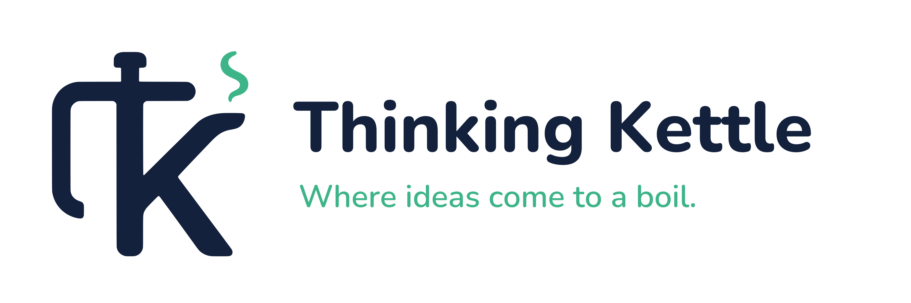

  <picture>
    <source media="(prefers-color-scheme: dark)" srcset="assets/tk-logo-horizontal-dark.png">
    
  </picture>

<h3 align="center">Where ideas come to a boil. ☕</h3>

---

Ciao! 👋 Qui è dove metto su l'acqua per le idee.

Con **Thinking Kettle** sviluppo software, porto avanti progetti IT, costruisco soluzioni di intelligenza artificiale e bot, e faccio consulenza. In poche parole, prendo un'idea grezza e la porto a bollore finché non diventa qualcosa che funziona davvero.

### 🫖 Cosa bolle in pentola

- **Sviluppo software** per app web e mobile su misura, senza fronzoli.
- **AI e bot** che automatizzano i lavori ripetitivi e ti liberano tempo.
- **Progetti IT** dall'analisi alla messa in produzione.
- **Consulenza** per capire cosa ti serve davvero, prima di scrivere una riga di codice.

### 🚀 Progetti in evidenza

| Progetto | Di cosa si tratta |
|---|---|
| [What'sUp Butler](https://github.com/ebravi/whatsup-butler) | Il task manager al tuo servizio. |

### 📬 Facciamo due chiacchiere

🌐 [thinkingkettle.it](https://thinkingkettle.it) · 🌍 [thinkingkettle.com](https://thinkingkettle.com)

Hai un'idea che sta ancora tiepida? Scrivimi e mettiamola sul fuoco.
